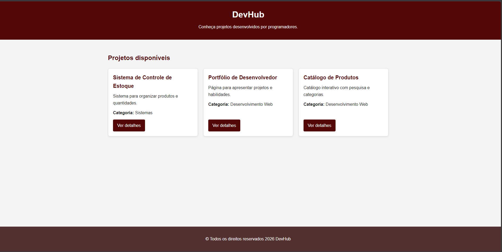
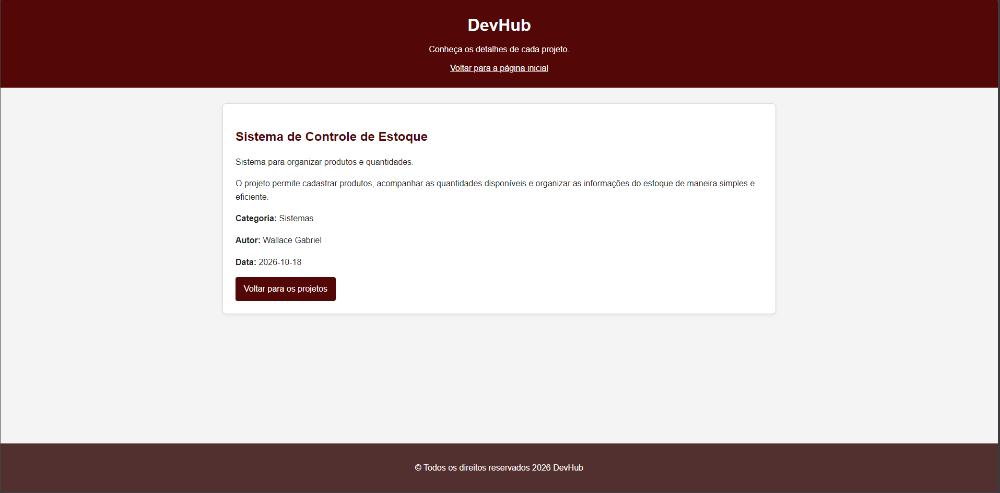

# DevHub - Portal de Projetos

## Sobre o projeto

O DevHub é um portal desenvolvido para apresentar projetos de programação de forma simples e organizada. A aplicação possui uma página inicial que exibe cards de projetos e uma página de detalhes que apresenta informações adicionais sobre cada projeto.

Os dados são armazenados em uma estrutura JavaScript no formato de objetos e arrays, permitindo que os cards e as páginas de detalhes sejam gerados dinamicamente.

## Autor

- **Nome:** Wallace Gabriel Moreira da Silva
- **Curso:** Bacharelado em Sistemas de Informação

## Tecnologias utilizadas

- HTML5
- CSS3
- JavaScript

## Funcionalidades

- Exibição dinâmica dos projetos na página inicial.
- Cards com título, descrição e categoria.
- Navegação para a página de detalhes de cada projeto.
- Identificação do projeto por meio do parâmetro `id` na URL.
- Exibição das informações completas do projeto selecionado.
- Layout responsivo para diferentes tamanhos de tela.

## Estrutura do projeto

```text
DevHub-Projeto-Academico/
├── public/
│   ├── css/
│   │   └── style.css
│   ├── imagens/
│   ├── js/
│   │   └── app.js
│   ├── index.html
│   └── detalhes.html
└── README.md
```

## Capturas de tela

### Página inicial



### Página de detalhes



## Estrutura de dados JSON

Os projetos são armazenados em um array de objetos JavaScript no arquivo `public/js/app.js`.

```javascript
const dados = [
    {
        id: 1,
        titulo: "Sistema de Controle de Estoque",
        descricao: "Sistema para organizar produtos e quantidades.",
        conteudo: "O projeto permite cadastrar produtos, acompanhar as quantidades disponíveis e organizar as informações do estoque de maneira simples e eficiente.",
        categoria: "Sistemas",
        autor: "Wallace Gabriel",
        data: "2026-10-18",
        imagem: "imagens/projeto1.png"
    },
    {
        id: 2,
        titulo: "Portfólio de Desenvolvedor",
        descricao: "Página para apresentar projetos e habilidades.",
        conteudo: "O portfólio apresenta informações profissionais, habilidades técnicas, tecnologias utilizadas e projetos desenvolvidos pelo programador.",
        categoria: "Desenvolvimento Web",
        autor: "Wallace Gabriel",
        data: "2026-10-18",
        imagem: "imagens/projeto2.png"
    },
    {
        id: 3,
        titulo: "Catálogo de Produtos",
        descricao: "Catálogo interativo com pesquisa e categorias.",
        conteudo: "O catálogo permite visualizar produtos, consultar suas descrições e organizar os resultados por categoria. A proposta é facilitar a navegação e a localização dos produtos.",
        categoria: "Desenvolvimento Web",
        autor: "Wallace Gabriel",
        data: "2026-10-18",
        imagem: "imagens/projeto3.png"
    }
];
```

## Como executar

1. Clone o repositório do GitHub.
2. Abra a pasta do projeto no Visual Studio Code.
3. Abra o arquivo `public/index.html` com a extensão Live Server.
4. Clique em "Ver detalhes" para consultar as informações de cada projeto.

## Observação

Os projetos apresentados e seus dados são fictícios e foram utilizados para demonstrar o funcionamento da aplicação.
